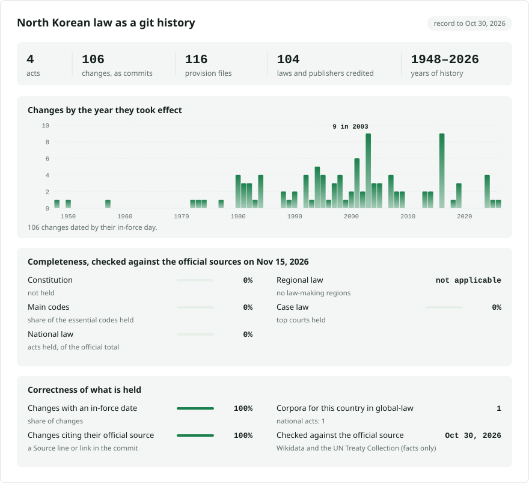

# North Korea: law history in git

<picture>
<source media="(prefers-color-scheme: dark)" srcset="data/effort-dark.svg">

</picture>

North Korea's law as a git history, on the design every country here shares: one file per entry, one commit per version on the day it took effect, and the record that made each change as the commit's author. For now it holds no law text, only facts: a catalogue of laws of the Democratic People's Republic of Korea and its actions on treaties. `git blame` names the record behind every line; `git log` lists every entry for a law or a treaty; picking a date gives the record as it stood that day.

Part of [lexifina/global-law](https://github.com/lexifina/global-law), one git history for every country's law: this is North Korea's national law, which global-law reads at `north-korea/national/acts/`.

**What is in it now:** no law text. [`catalogue/`](catalogue/README.md) lists 25 laws and other acts recorded by WIPO Lex (the Socialist Constitution, the Criminal Code and the Code of Criminal Procedures, 18 laws, most on intellectual property, foreign investment and trade, and 4 implementing regulations), with their titles, dates (1950 to 2025) and links. [`treaties/`](treaties/README.md) records 38 actions on 31 multilateral treaties deposited with the UN Secretary-General (19 accessions, 10 signatures, 6 ratifications, 2 approvals and 1 acceptance), from 19 May 1973 to 6 December 2016, and [`wipo-treaties/`](wipo-treaties/README.md) North Korea's part in 46 treaties as WIPO Lex records it. [`legal-system/`](legal-system/README.md) holds a few facts from Wikidata, among them six of its items for the constitutions. [`data/laws.csv`](data/laws.csv) lists the 107 records the commits are credited to; [`REPRODUCE.md`](REPRODUCE.md) says how the files were made.

**Why there is no law text.** No official source of North Korean law was found online that can be read and reused, so this record holds facts only; law text will be added once such a copy is found.

Each entry is one file: `catalogue/law-21231.md` is WIPO Lex's entry for the Socialist Constitution, adopted on 27 December 1972 and amended up to 29 August 2019. Each UN treaty is one file named from its number in the UN Treaty Collection: `treaties/untc-iv-11.md` is the Convention on the Rights of the Child (IV-11).

The records are in English, as WIPO Lex, the UN Treaty Collection and Wikidata give them.

## Questions as git commands

| Question | Command |
| --- | --- |
| Every action North Korea took on the Convention on the Rights of the Child | `git log -p --word-diff -- treaties/untc-iv-11.md` |
| Which action wrote each line? | `git blame treaties/untc-iv-11.md` |
| Every version of the Convention's record, with the day of each | `git log --format="%h %(trailers:key=In-force,valueonly,separator=) %an" -- treaties/untc-iv-11.md` |
| The record as it stood on 1 September 1990 | `python tools/on.py 1990-09-01 treaties untc-iv-11` |

**Outside git**, we also host this record publicly, for free:

- **[Ask Claude about North Korea](https://global-law.lexifina.com/v1/try_claude?country=north-korea)**: opens Claude with a first question ready.
- **[Ask ChatGPT](https://global-law.lexifina.com/v1/try_chatgpt?country=north-korea)**: the same question in ChatGPT.
- **[Search North Korea's record on our site](https://lexifina.com/law?country=north-korea&q=copyright)**: a search for "copyright" in its catalogue of titles, no account needed.
- **[Developer REST API](https://global-law.lexifina.com/v1/search_law?query=copyright&jurisdiction=north-korea)**: the same search as JSON, with no key. See the [documentation here](https://lexifina.com/api/global-law).

Both assistants read the record through the free Global law connector (MCP, `https://global-law.lexifina.com/mcp`); the first time, the chat gives you the link that adds it. Ask in Korean or in English.

**Host it yourself easily.** All it takes is git and Python, and the tools run on your machine:

```sh
git clone --depth 1 https://github.com/lexifina/global-law && cd global-law
python3 tools/countries.py add north-korea/national/acts
python3 tools/law.py show 2026-01-01 north-korea/national/acts/treaties/untc-iv-11.md
```

Opened in Claude Code, Cursor, VS Code or Codex, the clone also starts a local MCP server with the same tools ([MCP.md](https://github.com/lexifina/global-law/blob/main/MCP.md)).

## Dates

Each commit is dated at noon, Asia/Pyongyang, and carries its day in its `In-force:` trailer:

- for WIPO Lex's laws, the date WIPO Lex records (promulgation, entry into force, commencement or adoption, in that order): the day of adoption for all but the Intellectual Property Law, dated by its entry into force on 1 November 2025; a later "amended up to" date is only in the file;
- for treaties, the day of North Korea's action as the UN Treaty Collection or WIPO Lex records it; for the Wikidata facts, the state's inception (9 September 1948), then the day they were read (30 October 2026);
- git cannot store dates before 1970, so the 3 earlier commits are dated from 1970-01-01, one second apart, with the real day in `In-force:`. Ask for a date with `tools/on.py`, not `git log --before`.

Each UN treaty action is credited to the action (`Accession: Vienna Convention on Diplomatic Relations ...`), each WIPO Lex treaty action to its treaty and each day's catalogue entries to a record named for that day (`Catalogue entries of 1998-01-14`), with an e-mail address that cannot exist. The first version of `legal-system/`, `wipo-treaties/` and `treaties/`, the oldest available, is credited to the build's one publisher name, `Wikidata and the UN Treaty Collection (facts only)`, whatever its source.

## How it is checked

- `tools/check_repo.py` reads every version back from git on the day it took effect and on the day before and compares it with the corpus (not in this repository; its hash is in `data/corpus.sha256`); it also checks that every commit's trailers parse, that `main` has no merge commits and that no commit is dated in the future.
- `tools/build.py` writes the history from that one corpus file, and the same corpus gives the same commit hashes. [`REPRODUCE.md`](REPRODUCE.md) records that the checks were not yet run for this build and that no second build has been compared.
- `data/versions.json` gives each version's source. Only facts are taken: titles, subjects, dates and links.
- [vulnerabilities/](vulnerabilities/): possible drafting mistakes in this law, found by global-law's detectors and checked by hand. Not run yet.

## What it does not show

- **Law text.** Neither the Socialist Constitution nor any statute, decree or regulation is here as text.
- **Most of North Korea's laws.** The catalogue is WIPO Lex's list, mostly intellectual property, foreign investment and trade law; it is not a list of all laws. No case law.
- **Amendments and the day a law took effect.** Laws are dated by adoption, and the amendments WIPO Lex notes are not versions of their own.
- **Most treaty actions.** Only treaties on selected UN Treaty Collection status pages and WIPO Lex's list; no bilateral treaties, and no treaty text, reservations or declarations.
- **The 1997 notice on the ICCPR.** North Korea's notification of withdrawal from the International Covenant on Civil and Political Rights (25 August 1997) is not shown as an action; the UN Secretary-General's position is that withdrawal is not possible.

## Sources

| Source | Kind | Past versions | Notes |
| --- | --- | --- | --- |
| [WIPO Lex](https://www.wipo.int/wipolex/en/members/profile/KP) | Catalogue of laws and treaties (CC BY 4.0) | yes, each entry on the date it records | 25 laws and 46 treaties: titles, subjects, dates and links; read on 30 October 2026 |
| [United Nations Treaty Collection](https://treaties.un.org/) | Status pages of multilateral treaties deposited with the UN Secretary-General | yes, each action on its day | Facts only: treaty, action, date and depositary; read on 29 October 2026 |
| [Wikidata](https://www.wikidata.org/wiki/Q423) | Open facts (CC0) | one snapshot | The legal-system facts, community-edited, as Wikidata holds them |

## Licence

See [`LICENSE`](LICENSE). Only facts are taken, with no law or treaty text: treaty names, actions and dates, and WIPO Lex's titles, subjects, dates and links. WIPO Lex's content is CC BY 4.0 (source: World Intellectual Property Organization, which does not endorse this repository), and Wikidata's is CC0. Lexifina's arrangement, tables, commit messages and tools are CC0 1.0.

No AI model wrote, translated or corrected legal text; the scripts were written by an AI model, and no model runs when the history is built (see [`REPRODUCE.md`](REPRODUCE.md)).

## Visualisations

- [visualisations/](visualisations/): charts drawn from this repository. Not drawn yet.

## More

From [lexifina/global-law](https://github.com/lexifina/global-law):

- [FEATURES.md](https://github.com/lexifina/global-law/blob/main/FEATURES.md): every feature, and what every corpus must support (`git blame`, `law.py`, the MCP tools)
- [FAQ.md](https://github.com/lexifina/global-law/blob/main/FAQ.md): questions and answers · [CONTRIBUTING.md](https://github.com/lexifina/global-law/blob/main/CONTRIBUTING.md): proposing changes · [MCP.md](https://github.com/lexifina/global-law/blob/main/MCP.md): the MCP server · [REPRODUCE.md](https://github.com/lexifina/global-law/blob/main/REPRODUCE.md): how it was built · [CHANGELOG.md](https://github.com/lexifina/global-law/blob/main/CHANGELOG.md)
- [FRESHNESS.md](https://github.com/lexifina/global-law/blob/main/FRESHNESS.md): how current each corpus is · [Monitoring](https://github.com/lexifina/global-law/tree/main/monitoring): whether updates are running · [WATCHING.md](https://github.com/lexifina/global-law/blob/main/WATCHING.md): how each official source is watched for changes
- [performance/](https://github.com/lexifina/global-law/tree/main/performance): how fast the tools are, measured
- [visualisations/](https://github.com/lexifina/global-law/tree/main/visualisations): charts and bridges across the world's law
- [Vulnerabilities](https://github.com/lexifina/global-law/tree/main/vulnerabilities): mistakes in legislation as published
